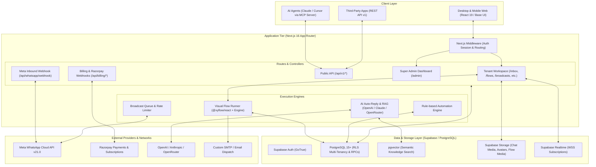
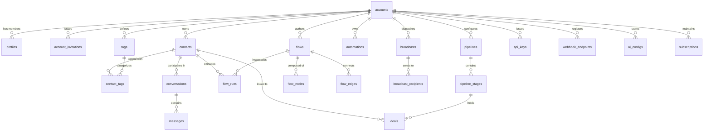
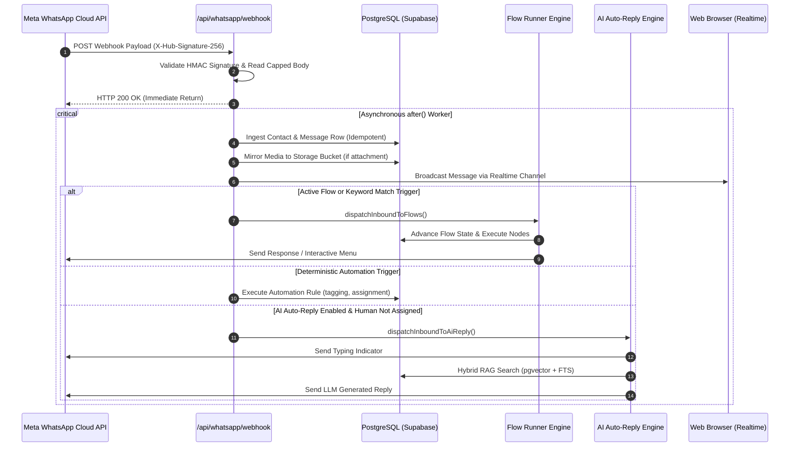
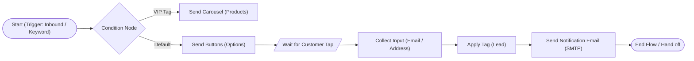
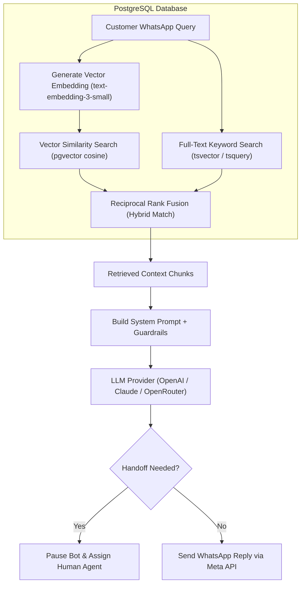

# Parsona (WAPP) — Complete Codebase Architecture & Technical Analysis

> **Analysis Date**: November 2026  
> **Repository**: `parsona` (v0.1.0)  
> **Primary Stack**: Next.js 16.3 (App Router), React 19.3, Supabase (PostgreSQL, RLS, Storage, Auth, Realtime), Tailwind CSS v4, Base UI, Meta WhatsApp Business Cloud API (v21.0), Razorpay, Model Context Protocol (MCP).

---

## Table of Contents

1. [Executive Summary & High-Level Architecture](#1-executive-summary--high-level-architecture)
2. [Technology Stack & Dependency Breakdown](#2-technology-stack--dependency-breakdown)
3. [Repository Directory & Module Structure](#3-repository-directory--module-structure)
4. [Database Architecture & PostgreSQL Schema (70 Migrations)](#4-database-architecture--postgresql-schema-70-migrations)
5. [Security, Authentication & Multitenancy](#5-security-authentication--multitenancy)
6. [WhatsApp Cloud API Core Engine](#6-whatsapp-cloud-api-core-engine)
7. [Visual Flow Builder & Automation Engine](#7-visual-flow-builder--automation-engine)
8. [AI Engine & Knowledge Base (RAG)](#8-ai-engine--knowledge-base-rag)
9. [CRM, Shared Inbox & Collaboration](#9-crm-shared-inbox--collaboration)
10. [Broadcasts & Campaign Engine](#10-broadcasts--campaign-engine)
11. [Billing & Subscription Infrastructure (Razorpay)](#11-billing--subscription-infrastructure-razorpay)
12. [Public REST API (v1) & MCP Server](#12-public-rest-api-v1--mcp-server)
13. [Internationalization & Localization (i18n)](#13-internationalization--localization-i18n)
14. [Testing Suite & Quality Assurance](#14-testing-suite--quality-assurance)
15. [Deployment, Cloudflare & Production DevOps](#15-deployment-cloudflare--production-devops)
16. [Key Findings, Technical Debt & Strategic Recommendations](#16-key-findings-technical-debt--strategic-recommendations)

---

## 1. Executive Summary & High-Level Architecture

**Parsona (internally named WAPP)** is a full-featured, self-hostable, multi-tenant Customer Relationship Management (CRM) and automation engine engineered directly on top of Meta's official **WhatsApp Business Cloud API (Graph API v21.0)**. 

Unlike conventional multi-tenant CRMs that rely on third-party WhatsApp gateway wrappers (e.g. Twilio, MessageBird, 360dialog), Parsona connects directly to Meta's Cloud API infrastructure. This guarantees lower per-message latency, zero third-party markups, complete data sovereignty, and direct support for Meta's modern features—such as Interactive Buttons, List Pickers, Multi-Card Carousels, Location Pins, WhatsApp Username/BSUID identification, and Meta Flow templates.

### Architectural Blueprint



### Core Architecture Highlights

1. **Next.js 16 App Router + React 19 Server Components (RSC)**: 
   Fast server-rendered layouts, minimal client-side hydration cost, and Server Actions for mutation workflows.
2. **True Database-Level Multi-Tenancy (Row Level Security - RLS)**:
   Every query is tenant-isolated at the PostgreSQL engine level via `account_id` and PostgreSQL functions (`is_account_member`, `is_super_admin`). Leaks between accounts are impossible even under zero-day application-level bugs.
3. **Decoupled Asynchronous Processing**:
   Heavy inbound webhook processing exploits Next.js 16's `after()` background execution pattern, returning an immediate HTTP 200 to Meta while processing database ingestion, media mirroring, flow execution, and AI responses asynchronously.
4. **Dual Build & Deployment Target**:
   First-class support for both standard Docker containerized Node.js runtime and **Cloudflare Workers** edge deployments powered by `@vinext/cloudflare` and Vite 8.

---

## 2. Technology Stack & Dependency Breakdown

### Runtime & Core Frameworks

| Package | Version | Purpose |
|---|---|---|
| `next` | `16.3.8` | App Router framework, server components, route handlers, middleware |
| `react` / `react-dom` | `19.3.1` | Modern React with Server Actions, Concurrent Mode, and Asset Preloading |
| `typescript` | `^6` (5.x/6) | Static typing across full application surface |
| `@supabase/supabase-js` | `^2.118.0` | Client library for PostgreSQL queries, auth, storage, and realtime channels |
| `@supabase/ssr` | `^0.12.7` | Next.js server component and middleware cookie session adapter |
| `vinext` | `^1.4.6` | Next.js compatible runtime adapter for Cloudflare Workers / Vite |
| `@vinext/cloudflare` | `^1.4.0` | Cloudflare Workers edge deployment plugin |

### UI, Styling & Visual Interaction

| Package | Version | Purpose |
|---|---|---|
| `tailwindcss` | `^4.0.0` | Tailwind CSS v4 engine (CSS-first configuration) |
| `@base-ui/react` | `^1.9.0` | Unstyled, fully accessible UI primitive components |
| `shadcn` | `^4.21.4` | Component definitions and utilities |
| `lucide-react` | `^1.55.0` | Vector UI icon set |
| `framer-motion` | `^14.14.0` | Fluid animations, drag indicators, transitions |
| `recharts` | `^3.10.1` | Analytics charts, volume trends, conversion funnels |
| `sonner` | `^2.0.8` | Toast notification framework |
| `clsx` / `tailwind-merge` | `2.1.1` / `3.7.0` | Conditional class utility merging |

### Graph & Workflow Builders

| Package | Version | Purpose |
|---|---|---|
| `@xyflow/react` | `^12.12.0` | React Flow visual canvas for building complex chatbot workflows |
| `@dagrejs/dagre` | `^3.1.1` | Directed graph layout algorithm for auto-arranging flow nodes |
| `@dnd-kit/core` | `^6.3.1` | Core drag-and-drop primitives for Kanban pipelines |
| `@dnd-kit/sortable` | `^10.0.0` | Sortable list & card implementation for deal pipeline stages |

### Audio & Messaging

| Package | Version | Purpose |
|---|---|---|
| `opus-recorder` | `^8.0.5` | In-browser Ogg Opus audio encoding for WhatsApp-compliant voice messages |
| `linkifyjs` / `linkify-react`| `^4.4.0` | Link, phone, and hashtag auto-detection in chat transcripts |
| `date-fns` | `^4.4.0` | Timestamp manipulation and relative date formatting |
| `next-intl` | `^4.14.9` | Full i18n support (ICU message formatting, multi-locale translation) |

### Developer Tools & Extensibility

| Package | Version | Purpose |
|---|---|---|
| `@modelcontextprotocol/sdk`| `^1.31.0` | Anthropic Model Context Protocol SDK for driving WAPP through AI assistants |
| `vitest` | `^5.0.5` | High-performance unit and integration testing runner |
| `eslint` / `prettier` | `^9` / `^3.9` | Linting and code formatting |

---

## 3. Repository Directory & Module Structure

```
Parsona/
├── .github/                      # GitHub Workflows (CI, schema verify, Docker builds)
├── docs/                         # Architecture documentation & guides
│   ├── auth-emails.md            # Supabase Auth email customization & redirect URLs
│   ├── cloudflare-deployment.md  # Cloudflare Workers / Vinext deployment instructions
│   ├── mcp.md                    # Model Context Protocol setup and tool reference
│   ├── multi-waba.md             # Multiple WhatsApp Business Account orchestration
│   ├── public-api.md             # REST API v1 documentation and authentication
│   └── whatsapp-connection-troubleshooting.md # Meta API setup guide
├── mcp-server/                   # Standalone Stdio Model Context Protocol (MCP) server
│   ├── src/
│   │   ├── client.ts             # HTTP client wrapping Parsona /api/v1
│   │   ├── config.ts             # Configuration parser (baseUrl, apiKey, readOnly)
│   │   ├── index.ts              # Stdio server entry point
│   │   └── tools/                # Registered tool definitions (read, write, broadcast)
│   ├── package.json
│   └── tsconfig.json
├── messages/                     # Localization message files (next-intl)
│   ├── en.json                   # English (Source of Truth)
│   ├── es.json                   # Spanish
│   ├── ko.json                   # Korean
│   └── pt.json                   # Portuguese (Brazil)
├── public/                       # Static public assets, audio workers, icons
├── src/
│   ├── app/                      # Next.js 16 App Router hierarchy
│   │   ├── (admin)/admin/        # Super Admin platform control center
│   │   ├── (auth)/               # Login, Signup, Forgot Password, Reset Password
│   │   ├── (dashboard)/          # Authenticated tenant application
│   │   │   ├── agents/           # Team member management & roles
│   │   │   ├── automations/      # Rule-based triggers & action builder
│   │   │   ├── broadcasts/       # Marketing broadcast campaign wizard & logs
│   │   │   ├── business/         # WhatsApp Business Profile configuration
│   │   │   ├── contacts/         # Contact directory, tags, import/export
│   │   │   ├── dashboard/        # Analytics, response times, message volume
│   │   │   ├── flows/            # Visual node-based workflow builder & runs
│   │   │   ├── inbox/            # Shared team inbox, chat bubbles, composer
│   │   │   ├── notifications/    # In-app alert notification center
│   │   │   ├── pipelines/        # Kanban deal pipelines & stages
│   │   │   └── settings/         # WABA credentials, AI config, API keys, Webhooks
│   │   ├── api/                  # Backend Route Handlers
│   │   │   ├── account/          # Account profile & settings
│   │   │   ├── admin/            # Super Admin APIs (tenants, impersonation, quotas)
│   │   │   ├── ai/               # AI completion, usage logs, knowledge base RAG
│   │   │   ├── automations/      # Automation CRON & execution endpoints
│   │   │   ├── billing/          # Razorpay orders, verification, webhooks
│   │   │   ├── business-profile/ # Meta WhatsApp business profile sync
│   │   │   ├── contacts/         # Contacts CRUD & bulk tagging
│   │   │   ├── email/            # SMTP config testing & dispatch
│   │   │   ├── flows/            # Visual flow CRUD, execution, template cloning
│   │   │   ├── invitations/      # Invite token validation & redemption
│   │   │   ├── quick-replies/    # Canned message CRUD
│   │   │   ├── v1/               # Public REST API (API key authenticated)
│   │   │   └── whatsapp/         # Webhooks, message sending, media, templates
│   │   ├── auth/callback/        # Supabase OAuth and PKCE callback
│   │   ├── join/[token]/         # Team invitation acceptance page
│   │   ├── globals.css           # Global Tailwind CSS v4 theme variables
│   │   ├── layout.tsx            # Root HTML layout with font loading & i18n
│   │   └── middleware.ts         # Authentication gate & cookie refresher
│   ├── components/               # React components organized by feature
│   │   ├── admin/                # Super Admin UI, tenant cards, quota forms
│   │   ├── agents/               # Member tables, invite dialogs, role selectors
│   │   ├── auth/                 # Login & registration forms
│   │   ├── automations/          # Automation list and step builder
│   │   ├── broadcasts/           # Broadcast wizard, template selector, audience filter
│   │   ├── business/             # WhatsApp Business profile settings form
│   │   ├── contacts/             # Contact table, CSV importer, tag filter
│   │   ├── dashboard/            # Tremor & Recharts analytics components
│   │   ├── flows/                # React Flow canvas, custom nodes, sidebar forms
│   │   ├── inbox/                # Chat list, thread, voice recorder, media previews
│   │   ├── notifications/        # Notification bell & drawer
│   │   ├── pipelines/            # Kanban board, deal cards, stage config
│   │   ├── presence/             # Realtime active user indicator
│   │   ├── settings/             # Settings tabs (Meta, AI, Keys, Webhooks, Billing)
│   │   └── ui/                   # Reusable atomic UI components (Button, Modal, Input)
│   ├── hooks/                    # Custom React hooks (Realtime, Auth, Media, Presence)
│   ├── i18n/                     # Next-intl routing, request handler, translation loader
│   ├── lib/                      # Core business logic, domain models, integrations
│   │   ├── account/              # Tenant resolution and membership helpers
│   │   ├── admin/                # Super admin verification and cookie impersonation
│   │   ├── ai/                   # AI providers (OpenAI, Anthropic, OpenRouter), RAG, prompts
│   │   ├── api/                  # API response formatting & v1 helpers
│   │   ├── api-keys/             # API key generation, SHA-256 hashing, verification
│   │   ├── auth/                 # Roles, capabilities, invitations, session helpers
│   │   ├── automations/          # Rule-based automation evaluator & executor
│   │   ├── billing/              # Razorpay order generation & signature verification
│   │   ├── contacts/             # Deduplication, phone normalisation, CSV parsing
│   │   ├── conversations/        # Conversation lifecycle, reopening, assignment
│   │   ├── dashboard/            # Metric aggregations and trend calculations
│   │   ├── email/                # Nodemailer SMTP transport service
│   │   ├── flows/                # Visual Flow graph runner, node dispatchers, validation
│   │   ├── inbox/                # Optimistic message caching & state management
│   │   ├── media/                # Storage upload, MIME validation, blob caching
│   │   ├── notifications/        # In-app notifications & browser push notifications
│   │   ├── pipelines/            # Deal creation, stage movement, currency conversion
│   │   ├── quick-replies/        # Canned response management
│   │   ├── settings/             # System settings storage
│   │   ├── storage/              # Supabase storage abstraction
│   │   ├── supabase/             # Browser & Server Supabase client factories
│   │   ├── webhooks/             # Outbound webhook delivery, SSRF prevention, HMAC
│   │   └── whatsapp/             # Meta Graph API client, Webhook parser, Encryption
│   └── types/                    # TypeScript interfaces and DB row mappings
├── supabase/
│   ├── config.toml               # Local Supabase CLI configuration
│   └── migrations/               # 70 sequential SQL migrations
├── cloudflare.config.ts          # Cloudflare Workers build manifest
├── next.config.ts                # Next.js 16 configuration with Turbopack & CSP headers
├── package.json                  # Dependencies and execution scripts
├── tsconfig.json                 # TypeScript compiler configuration
├── vite.config.ts                # Vite config for Cloudflare Vinext
└── vitest.config.ts              # Vitest test suite configuration
```

---

## 4. Database Architecture & PostgreSQL Schema (70 Migrations)

Parsona features a sophisticated relational schema defined across 70 database migrations in `supabase/migrations`. The schema is fully idempotent, strongly typed with PostgreSQL enums, optimized with compound indexes, and protected by PostgreSQL Row Level Security (RLS).

### Schema Evolution Timeline

```
001_initial_schema.sql ──────► Core tables: profiles, contacts, tags, conversations, messages, pipelines
006_automations.sql ─────────► Rule triggers, action configs, execution counters
010_flows.sql ───────────────► Visual Flow graphs (flows, flow_nodes, flow_edges, flow_runs)
017_account_sharing.sql ─────► True multi-tenancy: accounts, account_members, account_invitations
022_contact_phone_dedup.sql ─► Digits-only normalized phone generation & uniqueness constraints
026_api_keys.sql ────────────► SHA-256 hashed public API tokens with granular scopes
028_webhook_endpoints.sql ───► Outbound webhook destinations with secret rotation
029_ai_reply.sql ────────────► AI configuration, system prompts, turn limits, provider options
030_ai_knowledge.sql ────────► pgvector integration, embeddings, document chunking & RAG
035_interactive_messages.sql ► Interactive button payloads, list rows, carousel cards
039_inbound_media_mirror.sql ► Inbound media mirroring into Supabase Storage buckets
040_contact_bsuid.sql ───────► Meta username migration support (wa_user_id & BSUID)
060_super_admin_foundation.sql► Platform admin bypass, tenant status, plan quotas, template cloning
061_razorpay_subscriptions.sql► Subscriptions, orders, invoices, payment status tracking
067_unified_flows.sql ───────► Unified Flow and Automation architecture
070_ai_usage_cost.sql ───────► Token usage accounting and per-tenant AI cost tracking
```

### Core Relational Entity Model



### Table Definitions & Key Structures

#### 1. Multitenancy & Identity
- **`accounts`**: The core tenant boundary (`id`, `name`, `owner_user_id`, `status`, `plan_tier`, `max_contacts`, `max_broadcasts_per_month`, `max_agents`, `ai_enabled`, `default_currency`).
- **`profiles`**: User metadata associated with `auth.users` (`id`, `user_id`, `full_name`, `email`, `avatar_url`, `account_id`, `account_role`, `is_super_admin`).
- **`account_invitations`**: Pending team invitations (`token_hash`, `role`, `expires_at`, `accepted_at`).

#### 2. Contacts & CRM
- **`contacts`**: Core customer entities. Features unique normalized phone digits per account (`phone_normalized`), Meta Business-Scoped User ID (`wa_user_id`), portfolio ID (`wa_parent_user_id`), and display name.
- **`tags` & `contact_tags`**: Color-coded taxonomy labels for segmentation.
- **`custom_fields` & `contact_custom_values`**: Extensible attributes (Text, Number, Date, Dropdown).
- **`contact_notes`**: Internal team collaboration notes per customer.

#### 3. Conversations & Messages
- **`conversations`**: Thread between a contact and the tenant (`status`: `open`, `pending`, `closed`, `assigned_agent_id`, `unread_count`, `ai_autoreply_disabled`, `ai_reply_count`, `ai_handoff_summary`).
- **`messages`**: Inbound and outbound events (`sender_type`: `customer`, `agent`, `bot`; `content_type`: `text`, `image`, `document`, `audio`, `video`, `location`, `template`, `interactive`, `contacts`; `status`: `sending`, `sent`, `delivered`, `read`, `failed`; `meta_message_id`).

#### 4. Visual Flows & Automations
- **`flows`**: Node-based conversational graph definitions (`name`, `status`, `trigger_type`, `is_template`, `template_category`, `viewport`).
- **`flow_nodes`**: Graph vertices (`node_type`: `send_message`, `send_buttons`, `send_list`, `send_carousel`, `condition`, `delay`, `set_tag`, `send_email`, `request_address`, `ai_reply`, `config` JSONB, `position_x`, `position_y`).
- **`flow_edges`**: Graph transitions (`source_node_id`, `target_node_id`, `source_handle`).
- **`flow_runs`**: Active contact executions (`contact_id`, `current_node_key`, `status`: `running`, `waiting_input`, `completed`, `failed`, `state` JSONB).

#### 5. Artificial Intelligence & Vector Search
- **`ai_configs`**: Per-account LLM configuration (`provider`: `openai`, `anthropic`, `openrouter`, `openai_compatible`; encrypted API keys; `model`; `system_prompt`; `temperature`; `auto_reply_enabled`; `auto_reply_max_per_conversation`).
- **`ai_knowledge_docs`**: Indexed documents and FAQ articles.
- **`ai_knowledge_chunks`**: Text chunks paired with vector embeddings:
  ```sql
  embedding vector(1536) -- pgvector extension for high-speed cosine similarity
  ```
- **`ai_usage_logs`**: Token spending and cost accounting (`prompt_tokens`, `completion_tokens`, `estimated_cost_usd`).

#### 6. Sales Pipelines & Kanban
- **`pipelines`**: Funnel definitions (`name`, `is_default`, `order_index`).
- **`pipeline_stages`**: Steps in the funnel (`pipeline_id`, `name`, `order_index`, `color`).
- **`deals`**: Opportunities (`contact_id`, `stage_id`, `title`, `value`, `currency`, `status`: `open`, `won`, `lost`).

#### 7. Billing & Subscriptions
- **`subscriptions`**: Active tenant billing plans linked to Razorpay (`plan_id`, `razorpay_subscription_id`, `status`, `current_period_end`).
- **`invoices`**: Historical payment records with downloadable invoice receipts.

---

## 5. Security, Authentication & Multitenancy

### 1. Dual-Tier Access Control

Parsona enforces strict separation of concerns across two authorization layers:

```
                          ┌────────────────────────┐
                          │   auth.users (GoTrue)  │
                          └───────────┬────────────┘
                                      │
                         ┌────────────┴────────────┐
                         ▼                         ▼
            ┌─────────────────────────┐ ┌──────────────────────┐
            │ Super Admin Layer       │ │ Tenant Membership    │
            │ (profiles.is_super_admin│ │ (account_members)    │
            │  = TRUE)                │ │                      │
            │                         │ │ Role Hierarchy:      │
            │ - Global tenant audit   │ │ 4. Owner             │
            │ - Quota & plan override │ │ 3. Admin             │
            │ - Tenant impersonation  │ │ 2. Agent             │
            │ - Master Flow templates │ │ 1. Viewer            │
            └─────────────────────────┘ └──────────────────────┘
```

#### Role Capabilities Matrix

| Capability | Super Admin | Owner (4) | Admin (3) | Agent (2) | Viewer (1) |
|---|:---:|:---:|:---:|:---:|:---:|
| Manage Global Tenants & System Quotas | ✅ | ❌ | ❌ | ❌ | ❌ |
| Impersonate Tenant Account | ✅ | ❌ | ❌ | ❌ | ❌ |
| Delete Account / Change Owner | ✅ | ✅ | ❌ | ❌ | ❌ |
| Invite Members & Modify Roles | ✅ | ✅ | ✅ | ❌ | ❌ |
| Edit Meta & AI API Credentials | ✅ | ✅ | ✅ | ❌ | ❌ |
| Create API Keys & Outbound Webhooks | ✅ | ✅ | ✅ | ❌ | ❌ |
| Send Messages & Run Broadcasts | ✅ | ✅ | ✅ | ✅ | ❌ |
| Move Deals & Edit Contacts | ✅ | ✅ | ✅ | ✅ | ❌ |
| View Shared Inbox & Transcripts | ✅ | ✅ | ✅ | ✅ | ✅ |

### 2. Tenant Isolation at the Engine Level (RLS)

Every database query runs under PostgreSQL Row Level Security. Tenant queries rely on the PostgreSQL function:

```sql
CREATE OR REPLACE FUNCTION is_account_member(
  target_account_id UUID,
  min_role account_role_enum DEFAULT 'viewer'
) RETURNS BOOLEAN AS $$
  SELECT CASE
    WHEN (SELECT is_super_admin FROM profiles WHERE user_id = auth.uid()) IS TRUE THEN TRUE
    ELSE EXISTS (
      SELECT 1 FROM profiles p
      WHERE p.user_id = auth.uid()
        AND p.account_id = target_account_id
        AND p.account_role >= min_role
    )
  END;
$$ LANGUAGE sql STABLE SECURITY DEFINER;
```

### 3. Cryptographic Storage & Key Management

- **AES-256-GCM Credential Encryption**: Sensitive third-party secrets (Meta Access Tokens, WhatsApp App Secrets, OpenAI / Anthropic / OpenRouter API keys) are encrypted before insertion into PostgreSQL using a 32-byte hex key (`ENCRYPTION_KEY`). Initialization vectors (IV) and authentication tags are packed alongside ciphertexts.
- **SHA-256 Public API Key Hashing**: Public API tokens issued to third parties (`wapp_live_...`) are hashed using SHA-256 before storage. Plaintext tokens are surfaced exactly once during creation.
- **HMAC-SHA256 Webhook Verification**: Inbound WhatsApp webhooks are validated against Meta's `X-Hub-Signature-256` header using the account's configured App Secret. Outbound webhooks dispatched by Parsona are signed with a per-endpoint secret.
- **SSRF Protection**: Outbound webhook delivery checks destination IPs against private/internal IP blocks (e.g. `10.0.0.0/8`, `127.0.0.0/8`, `192.168.0.0/16`, AWS metadata `169.254.169.254`) via `src/lib/webhooks/ssrf.ts` to prevent internal network scanning.

---

## 6. WhatsApp Cloud API Core Engine

Parsona interfaces directly with Meta's Graph API `v21.0` via `src/lib/whatsapp/meta-api.ts`.

### Inbound Webhook Execution Pipeline



### Key Capabilities

1. **Meta Username & BSUID Compatibility**:
   Supports Meta's username rollout where customer phone numbers are masked. Identifies senders through Business-Scoped User IDs (`from_user_id`) without database collision.
2. **Interactive Message Types**:
   - Quick Reply Buttons (up to 3 buttons per message).
   - Interactive List Menus (up to 10 options divided into sections).
   - Product / Card Carousels (multi-card horizontal scroll with custom buttons).
   - Location Pin and Contact Card sharing.
3. **Inbound Media Mirroring**:
   Customer audio, images, documents, and videos are automatically downloaded from Meta's temporary CDN and archived in tenant-scoped Supabase Storage buckets, ensuring attachments never expire.
4. **Template Management**:
   Synchronizes approved message templates from Meta, validates body parameters (`{{1}}`, `{{2}}`), and supports direct template creation and deletion from the CRM UI.

---

## 7. Visual Flow Builder & Automation Engine

Parsona includes a visual node-based workflow builder located at `/flows`, built with `@xyflow/react` (React Flow v12) and Dagre auto-layout.

### Flow Architecture & Node Types



### Supported Flow Node Primitives

1. **`start`**: Entry trigger configured by keyword, message match, or tag event.
2. **`send_message`**: Text response supporting contact variable interpolation.
3. **`send_buttons`**: Up to 3 interactive reply buttons with branching edges.
4. **`send_list`**: Interactive menu with structured sections and rows.
5. **`send_carousel`**: Multi-card visual message with action buttons.
6. **`send_media`**: Image, PDF document, or audio attachment.
7. **`send_location`** / **`send_contact`**: Native WhatsApp cards.
8. **`request_address`**: WhatsApp native address collection message.
9. **`condition`**: Logical branching evaluating variables, tags, or message contents.
10. **`set_tag`** / **`remove_tag`**: Modifies CRM contact tags dynamically.
11. **`send_email`**: Dispatches notification emails via custom SMTP transport.
12. **`delay`**: Pauses run execution for a defined duration.
13. **`ai_reply`**: Dynamically generates an AI response before resuming the flow.

### Concurrency & Reliability Controls
- **Idempotency**: Runs track `meta_message_id` to discard duplicate webhook retries from Meta.
- **Optimistic Locking**: State transitions check `current_node_key` preconditions to prevent race conditions during rapid user taps.
- **Single Active Run Per Contact**: An index constraint (`idx_one_active_run_per_contact`) prevents multiple simultaneous workflows from colliding on the same user.

---

## 8. AI Engine & Knowledge Base (RAG)

Parsona features an AI co-pilot and automated responder (`src/lib/ai/`) that integrates directly into the shared inbox and flow engine.

### Hybrid RAG Architecture



### Key AI Features

- **Multi-Provider Support**: 
  - OpenAI (GPT-4o, GPT-4o-mini).
  - Anthropic (Claude 3.5 Sonnet, Claude 3 Haiku).
  - OpenRouter (unified access to hundreds of open-source and proprietary models).
  - Custom OpenAI-Compatible endpoints (vLLM, Ollama, LocalAI).
- **Safety Guardrails & Handoff**:
  - Automatically identifies user frustration or complex queries and performs a human handoff, leaving an internal summary note on the conversation thread.
  - Per-conversation turn limits prevent infinite conversational loops.
  - Account-wide token rate limiters prevent sudden credit exhaustion from viral bursts.
- **Knowledge Base Ingestion**:
  Supports indexing company documents, terms, and FAQs. Text is chunked, embedded via `text-embedding-3-small`, and queried using hybrid search combining `pgvector` with PostgreSQL full-text search.

---

## 9. CRM, Shared Inbox & Collaboration

Located at `/inbox`, the shared team inbox allows multiple agents to collaborate over a single WhatsApp Business phone number.

### Core Inbox Capabilities

1. **Multi-Agent Assignment**: Assign threads to specific agents or queues (`open`, `pending`, `closed`).
2. **Real-Time Synchronization**: Live incoming messages, status ticks, and unread counters update instantly via Supabase Realtime WebSocket channels.
3. **Voice Note Recording**: Integrated in-browser microphone capture using `opus-recorder` generates Ogg Opus voice notes compatible with WhatsApp's native audio player.
4. **Rich Message Composer**: Supports attachments, emoji picker, canned quick replies (`/shortcut`), and Meta-approved template pickers.
5. **Customer Timeline Sidebar**: Displays contact attributes, assigned tags, custom field values, linked deals, and internal private notes.
6. **Visual Kanban Sales Pipelines**: At `/pipelines`, deals can be dragged across stages (`@dnd-kit/core`), tracking conversion rates, deal values, and multi-currency metrics.

---

## 10. Broadcasts & Campaign Engine

Parsona's broadcast engine (`/broadcasts`) sends personalized marketing and transactional broadcasts to targeted contact segments.

### Broadcast Architecture

1. **Meta Template Compliance**: Only Meta-approved templates can initiate outbound conversations outside the 24-hour service window.
2. **Dynamic Audience Segmentation**: Filter recipients using inclusion/exclusion tags, custom field values, and opt-in flags.
3. **Variable Mapping**: Dynamic variables (`{{1}}`, `{{2}}`) are mapped from contact fields (e.g. `name`, `company`).
4. **Resumable Delivery Queue**: High-volume broadcasts execute in chunked batches with delivery leases (`broadcast-delivery-lease.ts`). If an execution crashes or hits rate limits, it can be resumed from the last confirmed recipient without duplicates.
5. **Granular Analytics**: Tracks `sent`, `delivered`, `read`, and `failed` rates with real-time error explanations for invalid numbers or policy violations.

---

## 11. Billing & Subscription Infrastructure (Razorpay)

Located at `src/lib/billing/razorpay.ts` and `/api/billing/`, Parsona includes an integrated payment processing system powered by **Razorpay**.

### Billing Capabilities

- **Plan Tiers**: `free`, `starter`, `pro`, `enterprise`.
- **Quota Enforcement**:
  - `max_contacts`: Maximum allowed contacts before requiring an upgrade.
  - `max_broadcasts_per_month`: Outbound broadcast limits.
  - `max_agents`: Maximum team member seats per account.
  - `ai_enabled`: Gating AI auto-reply and RAG features.
- **Payment Verification**: Validates Razorpay client-side signatures using HMAC SHA-256 (`verifyRazorpaySignature`).
- **Webhook Automation**: Handles Razorpay webhooks (`subscription.activated`, `payment.captured`) to automatically upgrade tenant accounts and adjust quotas.
- **Negotiated Enterprise Pricing**: Allows Super Admins to configure custom pricing, discount tiers, and billing cycles per tenant.

---

## 12. Public REST API (v1) & MCP Server

Parsona provides two programmable integration surfaces for external software and AI systems.

### 1. Public REST API (`/api/v1`)

Fully documented in `docs/public-api.md`. Authenticated using bearer tokens generated in the Settings page (`wapp_live_...`).

| Endpoint | Method | Description |
|---|---|---|
| `/api/v1/me` | GET | Validates token and returns tenant profile and capabilities |
| `/api/v1/contacts` | GET / POST | List contacts with cursor pagination, or create/update contacts |
| `/api/v1/contacts/:id` | GET / PATCH / DELETE | Retrieve, update, or remove a contact |
| `/api/v1/conversations` | GET | List conversations with status and tag filters |
| `/api/v1/conversations/:id/messages` | GET | Retrieve conversation chat history |
| `/api/v1/messages` | POST | Send an outbound WhatsApp text or template message |
| `/api/v1/broadcasts` | GET / POST | Create and trigger marketing broadcasts |
| `/api/v1/webhooks` | GET / POST / DELETE | Register and manage third-party webhook subscriptions |

### 2. Standalone Model Context Protocol (MCP) Server

Located in `mcp-server/`, this provides a standardized Stdio Model Context Protocol interface for AI development environments (Claude Desktop, Cursor, Zed):

- **Tools Exposed**:
  - `get_account_info`: Retrieve tenant details.
  - `search_contacts` / `create_contact` / `update_contact`: Contact management.
  - `list_conversations` / `get_messages`: Chat transcript retrieval.
  - `send_message`: Outbound message dispatch.
  - `create_broadcast`: Triggering marketing campaigns.
- **Security Mode**: Includes a read-only safety switch (`WACRM_ENABLE_WRITES=false`) preventing destructive actions during conversational exploration.

---

## 13. Internationalization & Localization (i18n)

Parsona is pre-configured with complete multi-language support across all UI elements, validation errors, and system notifications via `next-intl`:

| Locale Code | Language | Coverage |
|:---:|---|---|
| `en` | English (Default) | 100% |
| `es` | Spanish | Complete UI & Error messages |
| `pt` | Portuguese (Brazil) | Complete UI & Error messages |
| `ko` | Korean | Complete UI & Error messages |

Translations are modularized into structured JSON namespaces (`Navigation`, `Inbox`, `Contacts`, `Flows`, `Settings`, `Validation`, etc.) in `messages/*.json`.

---

## 14. Testing Suite & Quality Assurance

Parsona maintains an extensive test suite executed via **Vitest**:

- **Total Test Files**: 169 test suites.
- **Total Unit & Integration Tests**: **1,055+ tests**.
- **Coverage Areas**:
  - Flow graph resolution, cycle detection, edge traversal, and fallback policies.
  - WhatsApp webhook signature verification and payload normalization.
  - Contact deduplication and phone number formatting.
  - Rate limiting, token bucket algorithms, and SSRF address checking.
  - RAG vector search similarity calculations and prompt generation.
  - Role-based permissions and capability predicates.

---

## 15. Deployment, Cloudflare & Production DevOps

Parsona offers two deployment options:

### 1. Docker & Containerized Node.js (Default)

The repository provides a multi-stage `Dockerfile` creating an optimized standalone server:
```dockerfile
# Uses Node 22 Alpine, builds standalone bundle in .next/standalone
FROM node:22-alpine AS runner
WORKDIR /app
COPY --from=builder /app/.next/standalone ./
COPY --from=builder /app/.next/static ./.next/static
EXPOSE 3000
CMD ["node", "server.js"]
```

### 2. Cloudflare Workers (Edge Deployment)

Powered by **Vinext** (`cloudflare.config.ts`, `vite.config.ts`):
- Runs full Next.js App Router code at Cloudflare edge locations with near-zero cold starts.
- Static assets deploy directly to Cloudflare Pages / KV.
- Edge functions interface directly with Supabase via HTTPS connection pooling.

---

## 16. Key Findings, Technical Debt & Strategic Recommendations

### Technical Strengths
- **Clean Separation of Concerns**: Strict architectural boundary between DB-level security (RLS), pure business logic (`src/lib/*`), and UI presentation (`src/components/*`).
- **Resilient Webhook Ingestion**: Next.js 16 `after()` background execution pattern prevents Meta webhook timeout retries under high load.
- **No Third-Party Message Markups**: Direct Meta Cloud API integration minimizes operating costs.
- **Full Extensibility**: First-class support for both human users (Web UI), automated systems (REST API v1), and LLMs (MCP Server).

### Identified Technical Debt & Windows Development Nuance
1. **Vitest Module Resolution on Windows**:
   In `vitest.config.ts`, line 6 defines:
   ```ts
   alias: { "@app-messages": new URL("./messages/en.json", import.meta.url).pathname }
   ```
   On Windows environments, `new URL(...).pathname` returns `/D:/...` with a leading slash. This causes path resolution errors in tests that import `@app-messages`.
   *Fix Recommendation*: Wrap with `fileURLToPath(new URL("./messages/en.json", import.meta.url))` to produce valid native paths on Windows, Linux, and macOS.
2. **Dual Engine Consolidation (`automations` vs `flows`)**:
   Migration `067_unified_flows_and_automations.sql` initiated the unification of legacy rule-based automations into visual flows. Complete deprecation of the older linear automation engine will reduce code duplication and simplify maintenance.
3. **Heavy Inbound Media Mirroring**:
   Inbound attachments are downloaded from Meta and uploaded to Supabase Storage within the webhook's `after()` lifecycle. Under high media bursts (e.g. video files), this may exhaust serverless function execution timeouts.
   *Fix Recommendation*: Offload large media downloads to a dedicated background task queue (e.g. Supabase Edge Functions or pg-boss queue).

---

## Conclusion

Parsona is a mature, production-grade WhatsApp CRM and workflow automation platform. Its clean architecture, robust RLS security model, direct Meta API integration, visual flow canvas, multi-provider AI co-pilot, and developer extensibility position it as a formidable self-hostable alternative to proprietary SaaS solutions.
