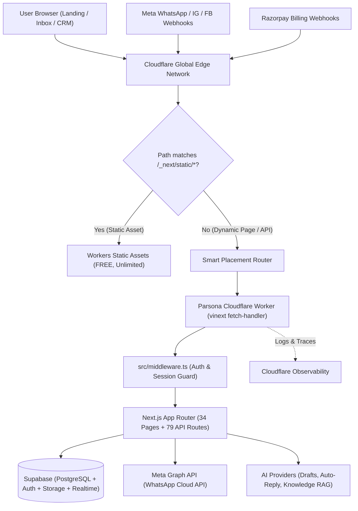
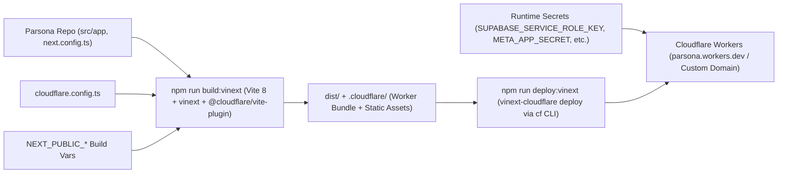

# Deploying Parsona on Cloudflare Workers (with `vinext` & `cf` CLI)

This guide explains **everything that was set up** to deploy Parsona (Next.js 16 + Supabase + WhatsApp CRM) on **Cloudflare Workers**, how the underlying technologies (`vinext`, Vite 8, `cf`, Workers Static Assets, Smart Placement) work together, **cost economics**, and the **end-to-end deployment & post-deploy checklist**.

---

## 1. What Is `vinext` and the Cloudflare Stack?

When deploying a Next.js app to Cloudflare, there are two main approaches: **vinext** (Cloudflare's current default for new setups) and **OpenNext** (legacy adapter). Parsona is configured with **vinext + `cf` CLI**.

| Technology | What It Is | Role in Parsona |
| :--- | :--- | :--- |
| **Cloudflare Workers** | Serverless V8 isolate runtime running in 300+ global edge locations with ~0ms cold starts. | Runs all 34 App Router pages (SSR/RSC), 79 API route handlers, and `src/middleware.ts`. |
| **`vinext`** | Cloudflare's open-source Next.js API implementation built on **Vite 8**. | Replaces the Webpack/Turbopack build pipeline with Vite for Cloudflare deployment while keeping your existing `src/app/`, `next/*` imports, `next.config.ts`, and `next dev`/`next build` intact. |
| **`@cloudflare/vite-plugin`** | Official Vite plugin integrating Cloudflare's `workerd` runtime directly into Vite. | Runs your RSC (`rsc`) and SSR (`ssr`) environments locally in the real Workers runtime and builds the production Worker bundle. |
| **`cf` CLI (`cloudflare.config.ts`)** | Cloudflare's modern typed CLI & TypeScript configuration file (successor to `wrangler.toml`/`wrangler.jsonc` for new projects). | Manages Worker deployment, static assets, bindings, observability, and account targeting from a type-safe `cloudflare.config.ts`. |
| **Workers Static Assets** | Built-in static file hosting attached directly to a Worker (`ASSETS` binding). | Serves `/_next/static/*`, fonts, icons, and `public/*` directly from Cloudflare's edge **for free**, without invoking your Worker JS. |
| **Smart Placement** | Cloudflare's automatic routing optimizer (`placement: { mode: "smart" }`). | Automatically executes your Worker close to your **Supabase PostgreSQL database** rather than far away from it, cutting multi-query DB round-trip latency. |
| **Workers Observability** | Built-in structured logs and traces (`observability: { enabled: true }`). | Captures request logs, errors, and performance traces in the Cloudflare Dashboard without external logging SaaS. |

### Why `vinext` Instead of OpenNext or a Traditional VPS?
- **Non-destructive coexistence**: Your existing `npm run dev` and `npm run build` (Next.js 16) still work untouched.
- **Native Workers runtime**: Instead of wrapping a full Node.js Next.js standalone server in compatibility shims, `vinext` compiles App Router + RSC directly to standard Fetch/Web API modules that run natively on `workerd`.
- **Zero server management**: No Docker containers, Nginx reverse proxies, PM2 restarts, or SSL certificate renewals.

---

## 2. Architecture & Request Flow Diagrams

### Runtime Request Architecture



### Build & Deployment Pipeline



---

## 3. Summary of Setup Audit & Changes Made

Here is everything analyzed and executed during setup, including the issues discovered and resolved:

### Step 1: Project & Account Audit
- Checked for existing Wrangler/Cloudflare configs (none existed — clean slate for `cf` CLI).
- Inspected `next.config.ts` (Next.js 16.3.8, `next-intl`, security headers, `output: "standalone"`).
- Verified your connected Cloudflare account via MCP:
  - **Account**: `Sultancodess@gmail.com's Account`
  - **Account ID**: `fd8585703442eac3c58d08a1c97a1ff3`
- Verified `.env.local` variable keys and confirmed the app does not use `next/image` or ISR (`revalidatePath`/`revalidateTag`), so no extra Cloudflare Images or KV/R2 cache bindings are required upfront.

### Step 2: `vinext` Compatibility Scan (`npx vinext check`)
- **Result**: **93% compatible** (`19 supported`, `1 partial`, `1 non-blocking issue`).
  - **Imports**: 7/7 supported (`next/link`, `next/navigation`, `next/server`, `next/headers`, `next/og`, `next/font/google`, `next/script`).
  - **Libraries**: 3/3 compatible (`next-intl`, `tailwindcss`, `lucide-react`).
  - **Structure**: App Router (`src/app/`), 34 pages, 5 layouts, 79 route handlers, 32 loading boundaries, `src/middleware.ts`.
  - **Single flagged item**: `public/opus/encoderWorker.min.js` uses `__dirname`, but because it lives in `public/` and is served as a static file (not bundled by Vite), it does not impact Workers execution.

### Step 3: Initialization & Configuration Files
Ran `npx vinext init --platform=cloudflare --name=parsona --cdn-cache=none --data-cache=none --image-optimization=none --skip-check`, then customized the configuration:

| File | Purpose / Changes Made |
| :--- | :--- |
| `cloudflare.config.ts` | Defines Worker `parsona`, entrypoint `vinext/server/fetch-handler`, `accountId: "fd8585703442eac3c58d08a1c97a1ff3"`, `compatibilityDate: "2026-11-17"`, `ASSETS` binding (`runWorkerFirst: ["/*", "!/_next/static/*", "!/*/_next/static/*"]`), `observability: { enabled: true }`, and `placement: { mode: "smart" }`. |
| `vite.config.ts` | Configures Vite 8 with `vinext()` and `@cloudflare/vite-plugin` (`rsc` environment + `ssr` child environment). |
| `package.json` | Added `vinext`, `@vinext/cloudflare`, `react-server-dom-webpack`, `vite@8.3.0`, `@vitejs/plugin-react`, `@vitejs/plugin-rsc`, `@cloudflare/vite-plugin@beta`, `cf@latest`; upgraded React to `^19.3.1`; enabled `"type": "module"`; updated `engines.node` to `>=22.23.0`; added `dev:vinext`, `build:vinext`, `start:vinext`, and `deploy:vinext` scripts. |
| `.nvmrc` | Pinned to `22.23.0` so Cloudflare Workers Builds and Node version managers select a compatible Node.js runtime. |
| `tsconfig.json` | Added `.cloudflare/types/**/*.ts` to `include`. |
| `eslint.config.mjs` | Ignored `dist/**`, `.cloudflare/**`, and `.vinext/**` so ESLint does not lint generated Worker build output. |
| `.gitignore` | Ignored `/dist/`, `.vinext/`, `.cloudflare/`, and `.dev.vars`. |

### Step 4: Issues Discovered & Resolved During Verification
1. **Windows Rolldown Native Binding**: On Windows, npm skipped the optional `@rolldown/binding-win32-x64-msvc` package required by Vite 8's Rolldown bundler. Installed it locally with `--no-save` (so Linux CI builds are unaffected).
2. **Local Node.js Version Requirement**: Your local PC currently runs **Node.js `v22.13.0`**, while `@cloudflare/config` (loading `cloudflare.config.ts`) requires **Node.js `v22.18.0+`** (specifically `module.registerHooks`), and `cf` recommends **`>=22.23.0`**. See [Section 5](#5-step-by-step-deployment-guide) to upgrade Node locally or deploy directly via Cloudflare Workers Builds.
3. **ESM Route Types (`tsc --noEmit`)**: Enabling `"type": "module"` invalidated cached `.next/types/`. Ran `npx next typegen` and verified `npm run typecheck` passes with **0 errors**.

---

## 4. Cost Economics (Cloudflare Workers Pricing)

Cloudflare Workers uses a **CPU-time billing model** (not wall-clock duration). When Parsona waits 300ms for a Supabase query, 400ms for Meta's WhatsApp API, or 2 seconds for an AI reply, **you pay \$0 for that waiting time** — you are only billed for the few milliseconds of actual JS CPU execution.

### Plan Comparison (Official Cloudflare Standard Pricing)

| Metric | Workers Free (\$0/mo) | Workers Paid (\$5/mo base) |
| :--- | :--- | :--- |
| **Monthly Base Cost** | **\$0** | **\$5 / month** |
| **Static Assets (`/_next/static/*`, `public/*`)** | **Free & Unlimited** | **Free & Unlimited** |
| **Bandwidth / Egress Fees** | **\$0** | **\$0** |
| **Worker Requests** | 100,000 / day (resets midnight UTC) | 10 million / month included, then **+\$0.30 / million** |
| **CPU Time** | 10 ms max per invocation | 30 million CPU ms / month included, then **+\$0.02 / million CPU ms** (up to 5 min per request; default 30s) |
| **Subrequests (Supabase / Meta / AI calls)** | Free (not billed as extra requests) | Free (not billed as extra requests) |
| **Worker Bundle Size Limit** | 3 MB compressed | **10 MB compressed** |
| **Workers Logs (Observability)** | 200,000 events / day (3-day retention) | 20 million events / month included (7-day retention), then +\$0.60 / million |

> **Recommendation for Parsona**: Start on **Workers Paid (\$5/month)** for production. Because Parsona is a full-stack app (34 pages + 79 API routes + `next-intl` + Supabase + AI/flow engines), the compressed bundle size and SSR/API CPU bursts can easily exceed the Free plan's 3 MB bundle and 10 ms CPU limits.

### Estimated Monthly Cost Scenarios for Parsona

Assuming an average dynamic request (SSR page, Inbox API, or WhatsApp Webhook) uses **~5 ms of CPU time** (static JS/CSS/images are free and excluded):

| Stage | Dynamic Requests / mo | CPU Time Used | Estimated Cloudflare Cost |
| :--- | :--- | :--- | :--- |
| **MVP / Early Launch** (50–200 active users) | 500,000 | 2.5M CPU ms | **\$5.00 / mo** (fully inside included quota) |
| **Growing SaaS** (1,000+ businesses, active webhooks) | 5,000,000 | 25M CPU ms | **\$5.00 / mo** (fully inside included quota) |
| **High-Volume Scale** (heavy broadcasts & webhooks) | 20,000,000 | 100M CPU ms | **\$9.40 / mo** (\$5 base + \$3.00 extra reqs + \$1.40 extra CPU) |

### Cost Comparison vs. Alternatives (for an I/O-Heavy WhatsApp + AI App)

| Platform | Typical Monthly Cost (Growing SaaS) | Key Tradeoff |
| :--- | :--- | :--- |
| **Cloudflare Workers (Paid)** | **\$5 – \$10 / mo** | No wall-clock billing during AI/Supabase I/O wait, \$0 egress, global edge, ~0ms cold starts. |
| **Vercel Pro** | \$20 / seat / mo + bandwidth & GB-hr overages | Bills wall-clock function duration (expensive for slow AI/webhook calls) + \$0.15/GB Fast Data Transfer after 1 TB. |
| **Dedicated VPS / Docker** (DigitalOcean / Hostinger) | \$12 – \$48 / mo | Fixed cost, requires manual OS patching, SSL, zero-downtime deploy scripts, scaling, and separate CDN/WAF. |

*(Note: Remember to budget separately for **Supabase** (Free tier or \$25/mo Pro), **Meta WhatsApp conversation fees**, and **LLM API usage**.)*

---

## 5. Step-by-Step Deployment Guide

You can deploy Parsona in **two ways**: from your local machine using the `cf` CLI, or automatically on every `git push` using **Cloudflare Workers Builds**.

### Option A: Deploy via GitHub + Cloudflare Workers Builds (Recommended — Zero Local Node Upgrade Needed)

Cloudflare builds and deploys directly on Cloudflare's Linux runners whenever you push to `main`:

1. Push your committed changes (including `cloudflare.config.ts`, `vite.config.ts`, `.nvmrc`, `package.json`) to GitHub.
2. Open the [Cloudflare Dashboard](https://dash.cloudflare.com/) → **Compute (Workers)** → **Workers & Pages** → **Create** → **Import a repository**.
3. Select your **Parsona** Git repository and configure:
   - **Project / Worker name**: `parsona`
   - **Build command**: `npm run build:vinext`
   - **Deploy command**: `npm run deploy:vinext`
   - **Root directory**: `/` (leave default)
4. Add your **Build Environment Variables** (all `NEXT_PUBLIC_*` vars — see [Section 6](#6-environment-variables--secrets)) in the **Build configuration** section so Vite inlines them into the client bundle.
5. Click **Save and Deploy**.
6. Once the Worker is created, add your **Runtime Secrets** under **Settings → Variables and Secrets**.

---

### Option B: Deploy from Your Local Windows PC (`cf` CLI)

#### 1. Upgrade Node.js to `v22.23.0+` (or Node 24 LTS)
Your PC currently has `v22.13.0`. Upgrade using `winget` or the installer at [nodejs.org](https://nodejs.org/):

```powershell
winget upgrade OpenJS.NodeJS.LTS
# Restart your terminal, then verify:
node -v   # Should be >= v22.18.0 (recommended >= v22.23.0)
```

#### 2. Authenticate the `cf` CLI
```powershell
npx cf auth login
npx cf auth whoami
```

#### 3. Test Locally in the Workers Runtime
```powershell
# Start local dev server in workerd (http://localhost:3001)
npm run dev:vinext

# Or build & preview the exact production Worker bundle locally
npm run build:vinext
npm run start:vinext
```

#### 4. Deploy to Cloudflare Workers
```powershell
npm run build:vinext
npm run deploy:vinext
```

---

## 6. Environment Variables & Secrets

Parsona separates **public build-time variables** (inlined into browser JS during `vite build`) from **server-side runtime secrets** (encrypted at rest in Cloudflare Workers).

### Build-Time / Public Variables
Add these to Cloudflare **Build Variables** (and/or local `.env.local` before running `npm run build:vinext`):

| Variable | Description |
| :--- | :--- |
| `NEXT_PUBLIC_SUPABASE_URL` | Your Supabase project URL (`https://<ref>.supabase.co`) |
| `NEXT_PUBLIC_SUPABASE_ANON_KEY` | Supabase public anon key |
| `NEXT_PUBLIC_SUPABASE_PUBLISHABLE_KEY` | Supabase publishable key |
| `NEXT_PUBLIC_APP_URL` | **Update to your live Cloudflare URL** (e.g., `https://parsona.yourdomain.com` or `https://parsona.<subdomain>.workers.dev`) |
| `NEXT_PUBLIC_APP_LOCALE` | Default locale (`en`, `pt`, `es`, or `ko`) |

### Server-Side Runtime Secrets
Add these under **Cloudflare Dashboard → Workers & Pages → `parsona` → Settings → Variables and Secrets** (mark as **Secret**), OR upload via CLI:

```powershell
# Upload secrets individually (since cf single-secret put falls back to wrangler):
npx wrangler secret put SUPABASE_SERVICE_ROLE_KEY --name parsona
npx wrangler secret put ENCRYPTION_KEY --name parsona
npx wrangler secret put META_APP_SECRET --name parsona
npx wrangler secret put META_WEBHOOK_VERIFY_TOKEN --name parsona
```

| Secret | Description |
| :--- | :--- |
| `SUPABASE_SERVICE_ROLE_KEY` | Privileged Supabase server key (never expose to client!) |
| `ENCRYPTION_KEY` | Encryption key for stored tenant tokens/credentials |
| `META_APP_SECRET` | Meta App Secret for verifying WhatsApp/IG/FB webhook signatures |
| `META_WEBHOOK_VERIFY_TOKEN` | Verification token used during Meta webhook handshake |

*(Add any Razorpay, SMTP/Email, or AI provider keys here as secrets if your deployment uses them.)*

---

## 7. Post-Deployment Checklist (Critical for Parsona)

After your first deploy succeeds and you have your live URL (e.g., `https://parsona.yourdomain.com`), update these integrations:

### 1. Custom Domain
Add your custom domain in **Cloudflare Dashboard → Workers & Pages → `parsona` → Settings → Domains & Routes → Add Custom Domain**, or declare it in `cloudflare.config.ts`:
```ts
worker: defineWorker({
  name: "parsona",
  domains: ["parsona.yourdomain.com"],
  // ...
})
```
Cloudflare automatically provisions DNS records and HTTPS/TLS certificates.

### 2. Supabase Authentication URLs
In **Supabase Dashboard → Authentication → URL Configuration**:
- Set **Site URL** to `https://parsona.yourdomain.com`
- Add `https://parsona.yourdomain.com/auth/callback` to **Redirect URLs**

### 3. Meta WhatsApp / Instagram / Facebook Webhooks
In **Meta for Developers → Your App → WhatsApp / Webhooks → Configuration**:
- Update **Callback URL** to: `https://parsona.yourdomain.com/api/whatsapp/webhook`
- Confirm **Verify Token** matches your `META_WEBHOOK_VERIFY_TOKEN` secret.

### 4. Razorpay Billing Webhook (if enabled)
In **Razorpay Dashboard → Settings → Webhooks**:
- Point webhook URL to: `https://parsona.yourdomain.com/api/billing/razorpay-webhook`

### 5. Scheduled Automations & Flows (Cron Jobs)
Parsona has two cron endpoints:
- `/api/automations/cron`
- `/api/flows/cron`

You can trigger them periodically via a Cloudflare Cron Trigger Worker (or an external cron service hitting those endpoints with your cron auth header).

### 6. Content Security Policy (CSP) Note for Landing Page Fonts
`next.config.ts` currently sets `Content-Security-Policy-Report-Only`. Before switching it to enforced `Content-Security-Policy`, add Google Fonts to `style-src` and `font-src` so the landing page fonts (*Bricolage Grotesque*, *Instrument Sans*, *DM Mono*) are permitted:
- `style-src 'self' 'unsafe-inline' https://fonts.googleapis.com`
- `font-src 'self' data: https://fonts.gstatic.com`

---

## 8. Day-2 Operations & Troubleshooting

| Task / Issue | Command / Solution |
| :--- | :--- |
| **Stream live production logs** | `npx wrangler tail parsona` (or view in Cloudflare Dashboard → `parsona` → **Observability → Logs**) |
| **Error: `cloudflare.config.ts loading requires Node.js v22.18.0 or higher`** | Upgrade local Node.js (`winget upgrade OpenJS.NodeJS.LTS`) to `>=22.23.0` and restart your shell. |
| **Error: `Cannot find module '@rolldown/binding-win32-x64-msvc'`** | Known npm Windows optional-dependency bug. Run `npm install --no-save @rolldown/binding-win32-x64-msvc` locally. |
| **Stale Next.js route types during `npm run typecheck`** | Run `npx next typegen` before `npm run typecheck`. |
| **Roll back a bad deploy** | In Cloudflare Dashboard → `parsona` → **Deployments**, click **Rollback** on any previous version (takes effect globally in seconds). |
| **Keep using regular Next.js locally** | `npm run dev` and `npm run build` remain 100% intact alongside `dev:vinext` / `build:vinext`. |

