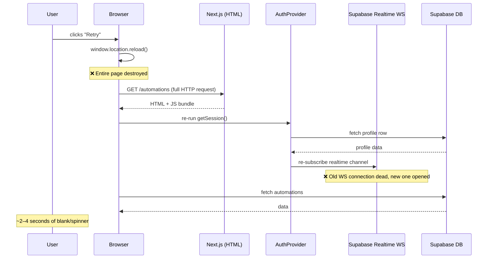
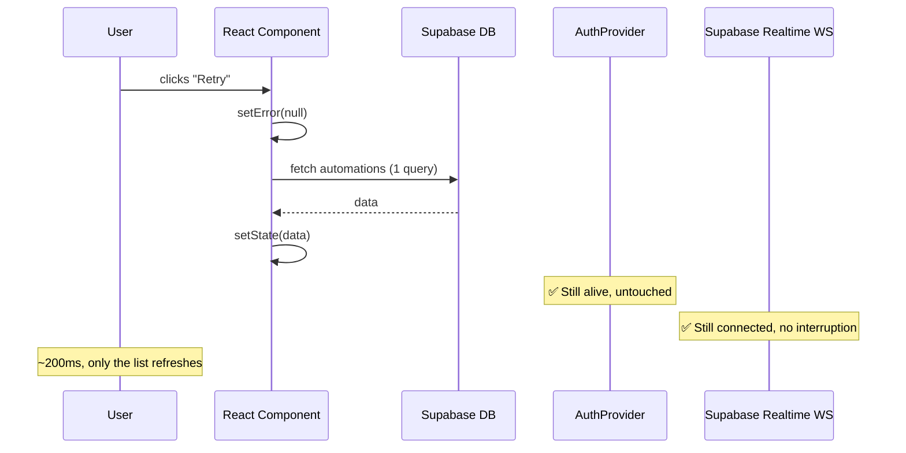
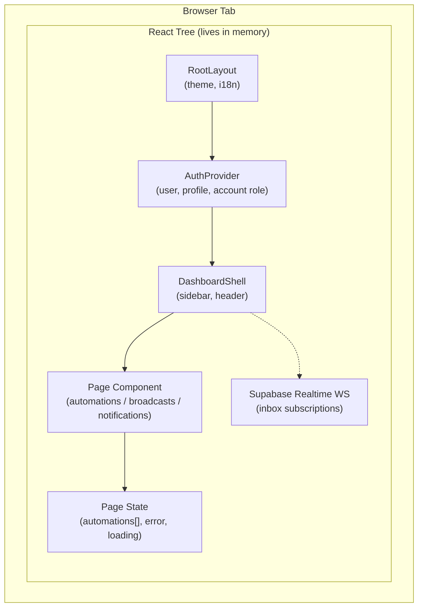
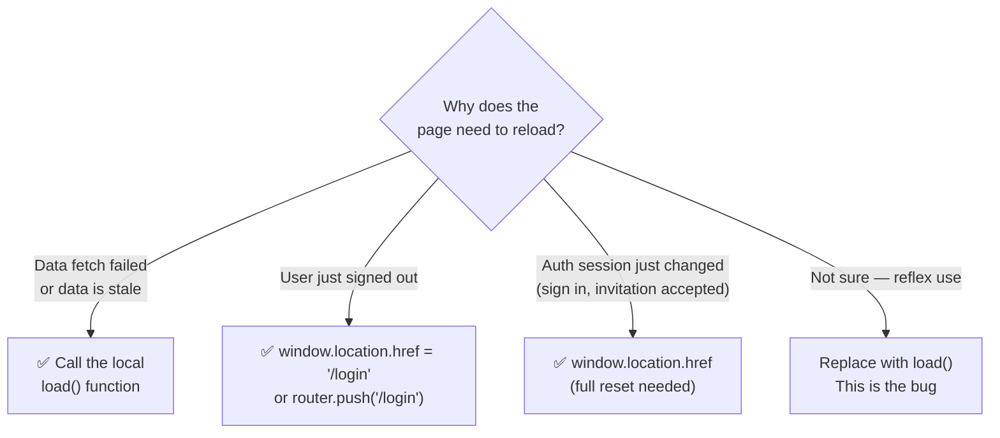
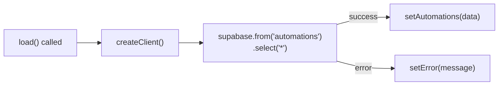
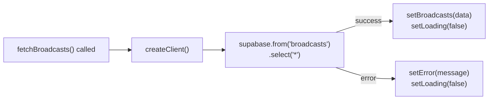
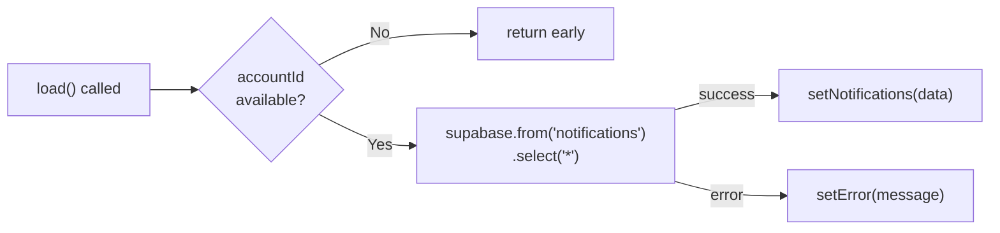
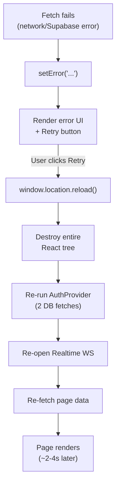
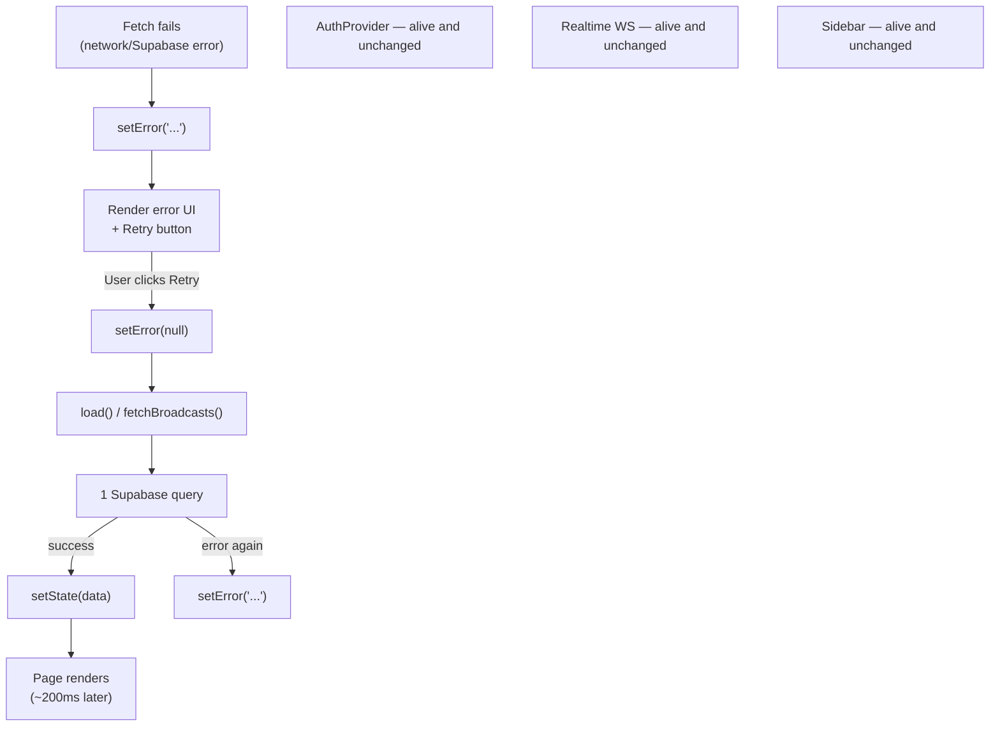

# Full-App Reload Problem — Manual Fix Guide

> This guide explains **why** the app was doing a full browser reload when a component needed to refresh its data, **how** to identify the pattern in any file, and **how** to fix it correctly.

---

## The Problem at a Glance

When a data fetch fails (network hiccup, Supabase timeout, etc.) the "Retry" button in some pages was calling:

```js
window.location.reload()
```

This is a **full browser reload** — identical to the user pressing F5. Everything is destroyed and rebuilt from scratch.

---

## What Actually Happens: Full Reload vs. Component Reload

### ❌ Bad Path — `window.location.reload()`



### ✅ Good Path — `load()` / `fetchBroadcasts()`



---

## App Architecture — What Survives vs. What Dies



> [!NOTE]
> When `window.location.reload()` is called, **everything in the React tree is destroyed** — including `AuthProvider`, the Realtime WebSocket, the sidebar state, etc. Only `Data` (the page's local state) needed to be reset.

---

## Identifying the Pattern

Search for this in any `.tsx` / `.ts` file under `src/`:

```bash
# PowerShell
Get-ChildItem -Recurse src -Include *.tsx,*.ts | Select-String "window\.location\.reload"

# bash / grep
grep -rn "window.location.reload" src/
```

Or in VS Code: `Ctrl+Shift+F` → search `window.location.reload`

### Decision Tree — Which reload is correct?



---

## The Three Files to Fix

### 1. `src/app/(dashboard)/automations/page.tsx`

**How to find it:** The `load()` function is defined at line ~71 as a plain `async function`. The error state is `const [error, setError] = useState<string | null>(null)`.

**Before (line ~145):**
```tsx
if (error) {
  return (
    <div className="flex h-64 flex-col items-center justify-center gap-2">
      <p className="text-sm text-red-400">{error}</p>
      <Button variant="outline" onClick={() => window.location.reload()}>  {/* ❌ */}
        {t("retry")}
      </Button>
    </div>
  )
}
```

**After:**
```tsx
if (error) {
  return (
    <div className="flex h-64 flex-col items-center justify-center gap-2">
      <p className="text-sm text-red-400">{error}</p>
      <Button variant="outline" onClick={() => { setError(null); load(); }}>  {/* ✅ */}
        {t("retry")}
      </Button>
    </div>
  )
}
```

**What `load()` does:**


---

### 2. `src/app/(dashboard)/broadcasts/page.tsx`

**How to find it:** The fetch function is called `fetchBroadcasts()` (not `load()`). The error state is `const [error, setError] = useState<string | null>(null)`. There is also a `loading` boolean — reset it to `true` so the spinner shows during the retry.

**Before (line ~147):**
```tsx
if (error) {
  return (
    <div className="flex h-64 flex-col items-center justify-center gap-2">
      <p className="text-sm text-red-400">{error}</p>
      <Button variant="outline" onClick={() => window.location.reload()}>  {/* ❌ */}
        {t('retry')}
      </Button>
    </div>
  );
}
```

**After:**
```tsx
if (error) {
  return (
    <div className="flex h-64 flex-col items-center justify-center gap-2">
      <p className="text-sm text-red-400">{error}</p>
      <Button variant="outline" onClick={() => { setError(null); setLoading(true); fetchBroadcasts(); }}>  {/* ✅ */}
        {t('retry')}
      </Button>
    </div>
  );
}
```

> [!TIP]
> `setLoading(true)` is needed here because `broadcasts/page.tsx` has a **separate loading block** that renders the spinner. Without it, the error block disappears but the data block shows stale empty state until `fetchBroadcasts` resolves.

**What `fetchBroadcasts()` does:**


---

### 3. `src/app/(dashboard)/notifications/page.tsx`

**How to find it:** The `load` function is a `useCallback` at line ~32. Error state: `const [error, setError] = useState<string | null>(null)`.

**Before (line ~159):**
```tsx
if (error) {
  return (
    <div className="flex h-64 flex-col items-center justify-center gap-2">
      <p className="text-sm text-destructive">{error}</p>
      <Button variant="outline" onClick={() => window.location.reload()}>  {/* ❌ */}
        {t("retry")}
      </Button>
    </div>
  );
}
```

**After:**
```tsx
if (error) {
  return (
    <div className="flex h-64 flex-col items-center justify-center gap-2">
      <p className="text-sm text-destructive">{error}</p>
      <Button variant="outline" onClick={() => { setError(null); load(); }}>  {/* ✅ */}
        {t("retry")}
      </Button>
    </div>
  );
}
```

**What `load()` does:**


---

## State Flow Comparison

### Before the Fix (Broken)



### After the Fix (Correct)



---

## General Rule for Future Pages

Whenever you add a new page with a data fetch + error state, follow this pattern:

```tsx
// 1. State
const [data, setData] = useState<MyType[] | null>(null);
const [error, setError] = useState<string | null>(null);
const [loading, setLoading] = useState(true);

// 2. Fetch function (plain async or useCallback)
const load = useCallback(async () => {
  setLoading(true);
  setError(null);
  try {
    const supabase = createClient();
    const { data, error: fetchErr } = await supabase.from('my_table').select('*');
    if (fetchErr) throw fetchErr;
    setData(data ?? []);
  } catch (err) {
    setError(err instanceof Error ? err.message : 'Failed to load');
  } finally {
    setLoading(false);
  }
}, []);

// 3. Initial fetch on mount
useEffect(() => { load(); }, [load]);

// 4. Error UI — always call load(), NEVER window.location.reload()
if (error) {
  return (
    <div>
      <p>{error}</p>
      <button onClick={() => { setError(null); load(); }}>
        Retry
      </button>
    </div>
  );
}
```

---

## Reference: Which `window.location.*` calls are intentional

| File | Pattern | Correct? | Why |
|---|---|---|---|
| `use-auth.tsx` — `signOut()` | `window.location.href = '/login'` | ✅ Yes | Auth session cleared; React state is stale with old user's data |
| `use-auth.tsx` — fallback | `window.location.href = '/login'` | ✅ Yes | Outside `AuthProvider`; no router available |
| `join/[token]/page.tsx` | `window.location.href = '/dashboard'` | ✅ Yes | Account context just changed after accepting invite |
| `sessions-card.tsx` | `window.location.href = '/login'` | ✅ Yes | User just invalidated their own token |
| `login/page.tsx` | `window.location.href = ...` | ✅ Yes | Post-auth hard navigate |
| `automations/page.tsx` — Retry | ~~`window.location.reload()`~~ → `load()` | ✅ Fixed | Only data was stale; auth/WS untouched |
| `broadcasts/page.tsx` — Retry | ~~`window.location.reload()`~~ → `fetchBroadcasts()` | ✅ Fixed | Only data was stale; auth/WS untouched |
| `notifications/page.tsx` — Retry | ~~`window.location.reload()`~~ → `load()` | ✅ Fixed | Only data was stale; auth/WS untouched |

